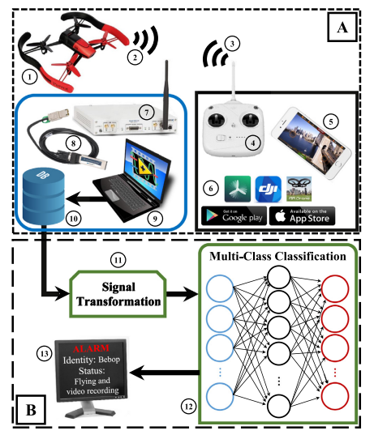
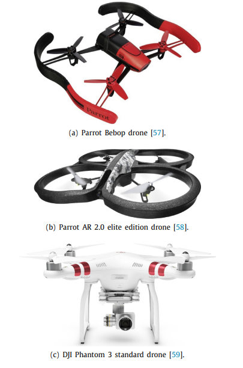
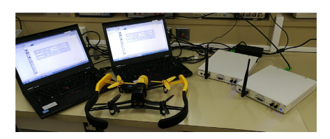
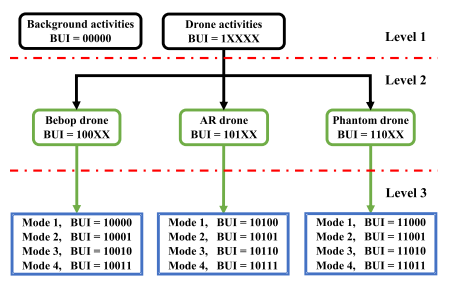
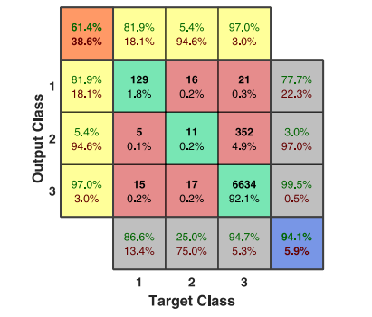
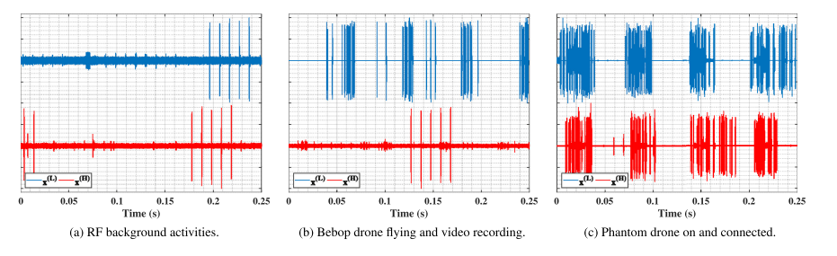
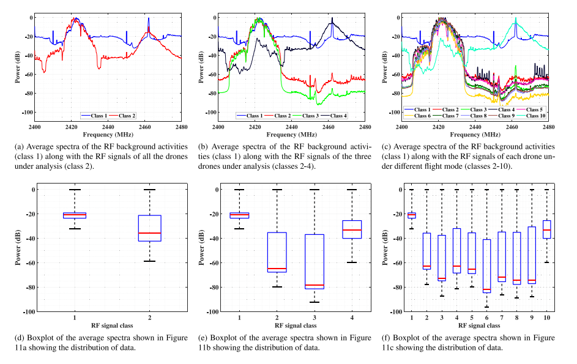
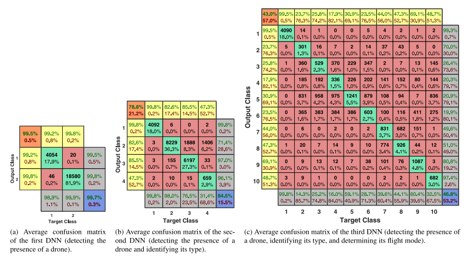

# [UAV] Detection and Recognition of Drones Based on Radio Frequency and Deep Learning: Preliminary Exploration for Building a Large Open-Source Drone Database with MATLAB + Python Code

The widespread use of civilian drones may lead to issues related to technology, safety, and public security, which urgently need to be addressed, regulated, and prevented. Security agencies have been continuously exploring technologies capable of detecting drones through intelligent systems. However, the breakthrough in related technologies has been hindered by the lack of open-source databases for drone radio frequency signals, which can be remotely sensed and stored, providing support for developing the most effective methods for detecting and identifying drones. This paper makes an important step towards building a database of various types of drone radio frequency signals under different flight modes. We systematically collected, analyzed, and recorded raw radio frequency signals from different drones under different flight modes (such as shutting down, on, connected, hovering, flying, and video recording). Additionally, we designed intelligent algorithms using the developed radio frequency database to detect and identify intruding drones. The research employed three deep neural networks, respectively achieving drone presence detection, drone presence and type identification, and drone presence, type, and flight mode recognition. Performance was validated through a 10-fold cross-validation process, with multiple indicators used for evaluation. Classification results showed that performance generally decreased with an increase in the number of categories. The average accuracy dropped from 99.7% in the first deep neural network (2 classes) to 84.5% in the second (4 classes), and finally to 46.8% in the third (10 classes). Despite this, the results of the designed method confirmed the feasibility of the developed drone radio frequency database for detection and identification. The developed drone radio frequency database and its implementation are publicly available for students and researchers to use.
Traditional methods for detecting and identifying drones, such as radar, visual, and acoustic methods, are not entirely reliable due to their susceptibility to limitations. Combining radio frequency sensing with deep learning methods holds promise for a solution, but is hindered by the lack of a database of drone radio frequency signals. In this paper, we build a new open-source database for storing the radio frequency signals of various drones under different flight modes on one hand, and test the developed database in a drone detection and recognition system designed using deep neural networks on the other hand. This work represents a step towards building a larger database by researchers' community, which will include more signals from other drones.
The rest of the paper is structured as follows: Section 2 provides an overview of related work. Section 3 introduces the system model and describes the methods for building and testing the database. Section 4 presents and discusses the results of the drone detection and recognition system, and finally concludes in Section 5.
Article illustrations
Conclusion With the increasing popularity of drones in civilian applications, regulatory bodies need intelligent systems capable of detecting and identifying intruders. However, the design of such systems is hindered by the lack of large, labeled open-source databases. This work contributes to achieving this goal by developing a drone radio frequency communication database. Researchers and students can further expand this database. The developed database contains radio frequency signals from various drones under different flight modes, thus it can be used for testing and validating intelligent algorithms and designing drone detection and recognition systems.
We collected, analyzed, and recorded the raw radio frequency signals of different drones under different flight modes (such as shutting down, turning on and connecting, hovering, flying, and video recording). To test the feasibility of the developed database, we used deep neural networks to detect and identify intruder drones and determined their flight modes. We designed, validated, and evaluated three deep neural networks to perform the following tasks: detecting the presence of drones, detecting the presence of drones and identifying their types, and detecting the presence of drones, identifying their types, and determining their flight modes.
The results of the developed system show that as the number of categories increases, performance generally decreases. The average accuracy drops from 99.7% in the first deep neural network (2 classes) to 84.5% in the second deep neural network (4 classes), and finally to 46.8% in the third deep neural network (10 classes). The results indicate that this decline is due to the similarities in the frequency spectrum of some drones (such as Bebop and AR drones), which are manufactured by the same company. This presents a challenging obstacle that can be mitigated through deeper neural networks or other advanced classification algorithms. Despite this, the results of the developed drone detection and recognition system confirm the feasibility of using the developed database for testing and validating intelligent algorithms as well as designing advanced drone detection and recognition systems. The developed drone radio frequency database is open-source and available on relevant platforms, along with all implementations necessary to reproduce the results of this work.
In the future, researchers can extract features from the developed drone radio frequency database for detection and compare them with our system's results. Additionally, the developed database can be used to train and test different detectors and network architectures to systematically find the best detection and recognition system. Moreover, integrating the developed database with other drone detection methods (such as camera images and videos, radar echoes and acoustic recordings) can improve the performance of the detection and recognition system by leveraging the advantages of each method. Researchers and students can expand the developed database in various ways, such as: studying other classification algorithms; enhancing the database by adding channel fading or noise; using other drones for the same experiments; studying the impact of radio frequency interference and noise on drone detection and recognition; conducting indoor and outdoor flight experiments; and changing the speed of the drone and its distance from the radio receiver.
Dataset Introduction
The following MATLAB and Python scripts are located in the GitHub code repository, used to generate the results and auxiliary charts shown in the paper. Please run the following scripts in order, starting from zero to regenerate all our results.
Main Script: Main_1_Data_aggregation.m description
This script generates MATLAB formatted data for use in subsequent scripts, Main_2_Data_labeling.m and Demo_3_Analysis.m.
Process
Load the original RF data, re-segment it by a factor of 100, convert it to the frequency domain using 2048 samples, and aggregate the results in MATLAB data format. The resulting files are: 00000.mat, 10000.mat, 10001.mat, 10010.mat, 10011.mat, 10100.mat, 10101.mat, 10110.mat, 10111.mat, and 11000.mat.
Main_2_Data_labeling.m description
This script generates csv format data for subsequent use in Classification.py.
Process
Load the MATLAB data file generated by Main_1_Data_aggregation.m, normalize it, concatenate it into a matrix, add classification labels, and save it as RF_Data.csv.
Classification.py description
This script generates CSV format data for subsequent use in Demo_4_Classification.m.
Process
1. Load the csv data file generated by Main_2_Data_labeling.m, extract radio frequency (RF) data and labels, and then train three deep neural networks (DNNs) to classify the RF data. Use a 10-fold cross-validation method to validate the DNNs. Calculate the predicted labels for each fold and save them as csv formatted data files.

Demonstration script: Demo_1_Database_details.m describes
The script generates the results shown in Table 4 of the paper.

Process
Calculate the number of raw samples and segmented samples for each category at each experimental level. Then, display the calculated details and the proportion of class sizes to check for class imbalance issues.

Demonstration script: Demo_2_Snippets.m describes
The script generates the results shown in Figure 11 of the paper.

Process
Load the fifth segment of the collected RF background activity, the tenth segment of the RF signal collected during Bebop drone flight and video recording, and the seventh segment of the RF signal collected during Phantom drone startup and connection. Then, normalize the amplitude of each segment and plot the normalized RF signals.

Demonstration script: Demo_3_Analysis.m describes
The script generates the results shown in Figure 12 of the paper.

Process
Load the MATLAB data file generated by Main_1_Data_aggregation.m. Then, take the average of all instances in each spectrum and smooth it with a 10-point moving average filter. Next, plot the average smoothed spectrum and its boxplot. Finally, ask the user whether to save the results as a PDF image. By changing the "opt" parameter from 1 to 2 and then to 3, you can generate the results shown in Figure 12 for each column.
Demo_4_Classification.m description
This script generates the results shown in Figure 13 of the paper [1].
Process
Load the csv data file generated by Classification.py. Then, concatenate all predicted labels and use MATLAB function plotconfusion_mod to calculate the corresponding confusion matrix. Finally, ask the user whether to save the result as a PDF image. By changing the "opt" parameter from 1 to 2 and then to 3, you can generate the results for each column in Figure 13.
Function: plotconfusion_mod description
This function is a modified version of the MATLAB built-in function plotconfusion.
Process
Compute the conventional confusion matrix, but using custom fonts and appending additional results, namely F1 scores. See Section 3.3.4 in [1].
References [1] M. Al-Sa'd et al. "UAV Detection and Recognition Based on Radio Frequency and Deep Learning: An Initial Exploration for Building a Large Open Source UAV Database," 2019.
[2] UAV Original Radio Frequency Data Base: https://tutfi-my.sharepoint.com/:f:/g/personal/mohammad_alsad_tut_fi/EtEuLLSAO9ROlefSh8Nzb18BswRNTo9vOUzE94rRjhrrxQ?e=n2H1je
[3] M. F. Al-Sa'd, A. Al-Ali, A. Mohamed, T. Khattab, the collected UAV RF database and used software are available online (2019). URL: https://al-sad.github.io/DDI_Software/
End

## Images

<!-- PAYMENT_BLOCK -->

## Get this dataset

- Payment link (Stripe): [Buy now](https://buy.stripe.com/3cs8yP7sY87d0vu9AB)
- Payment QR code: 

<!-- /PAYMENT_BLOCK -->
